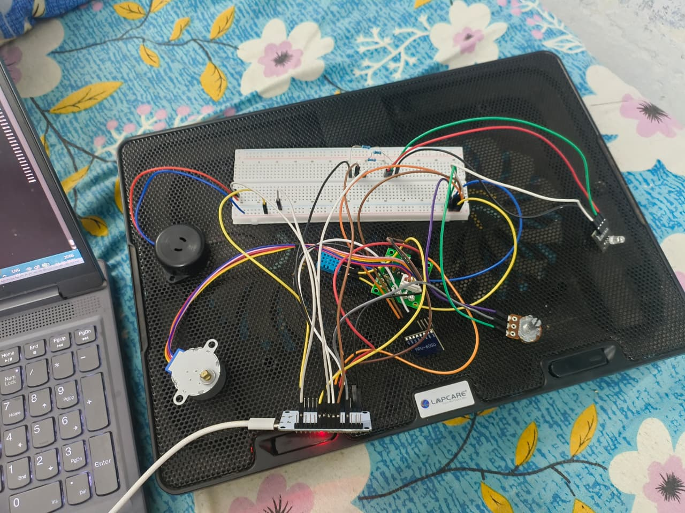
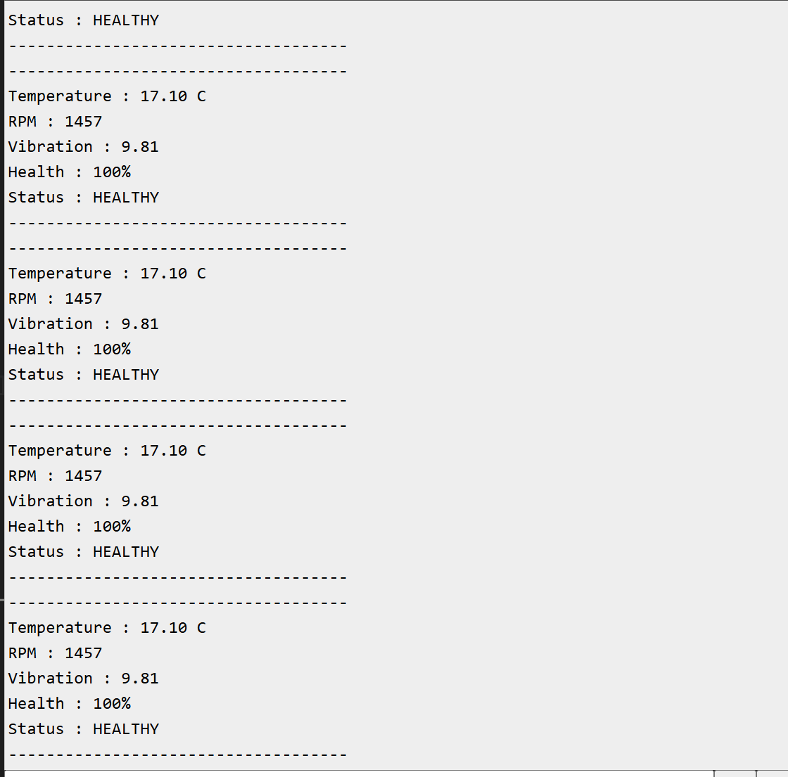
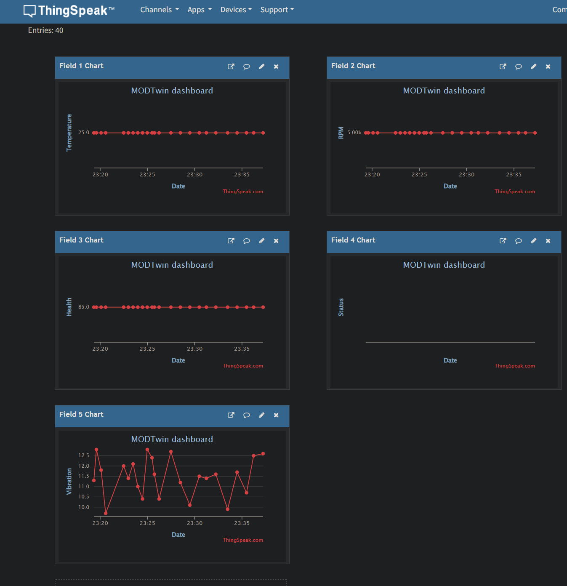
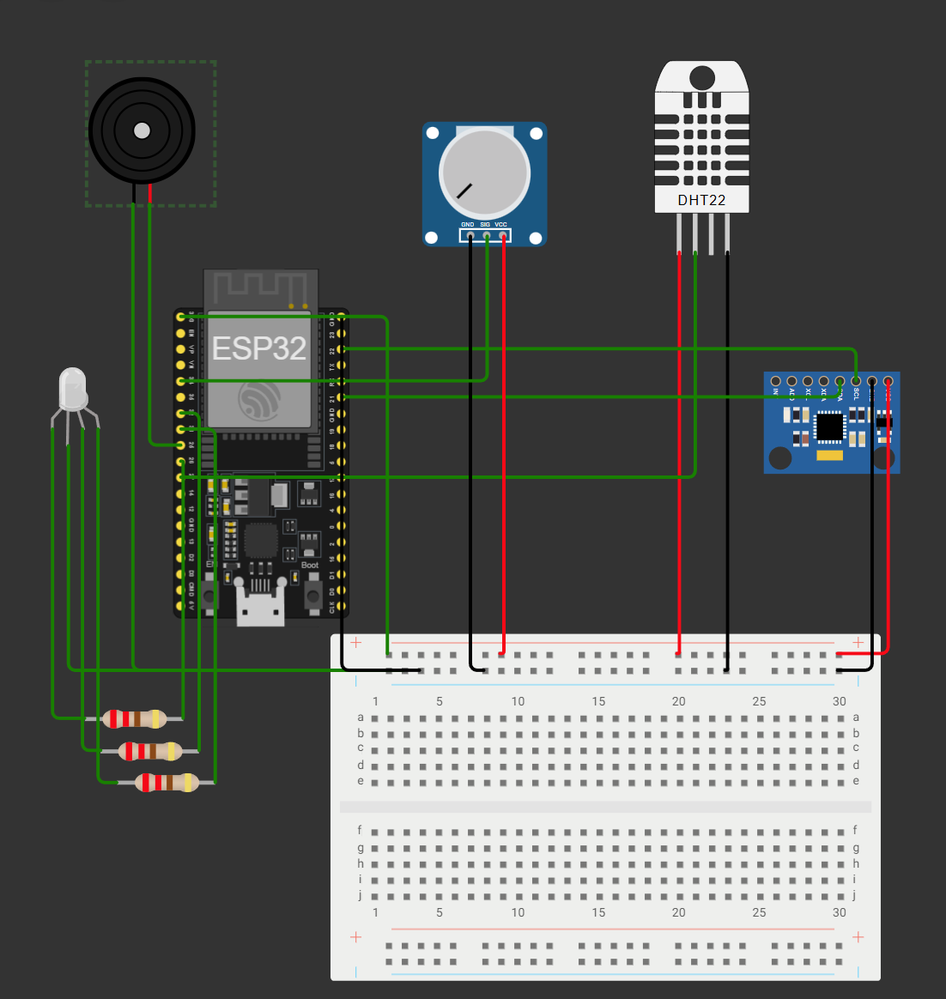

# MODTwin - Modular IoT-Based Digital Twin for Machine Health Monitoring

**An ESP32-based prototype for monitoring machine operating conditions, assessing health, and communicating system status through an IoT dashboard.**

MODTwin explores how low-cost embedded systems and IoT technologies can be used to monitor rotating machinery, identify abnormal operating conditions, and support condition-based maintenance.

The project combines sensor data acquisition, rule-based health assessment, status indication, and cloud-based data visualization in a modular architecture designed for future expansion.

## Project Overview

Rotating machinery can experience faults due to excessive temperature, vibration, or abnormal operating speeds. Monitoring these parameters can help identify potentially unhealthy operating conditions before they lead to equipment failure.

MODTwin is being developed as a modular platform that connects physical or simulated machine parameters to an embedded monitoring system and a cloud dashboard.

The current prototype focuses on establishing the core monitoring pipeline before progressing towards real-time sensor integration and predictive maintenance.

## System Architecture

```text
Machine Parameters
       |
       v
Sensor Inputs / Simulated Data
       |
       v
ESP32 Data Acquisition
       |
       v
Rule-Based Health Assessment
       |
       v
Health Score + Operating Status
       |
       +------> LED / Buzzer Alerts
       |
       v
Wi-Fi Communication
       |
       v
ThingSpeak IoT Dashboard
```

## Key Features

- **Embedded monitoring:** ESP32-based data acquisition and processing.
- **Operating parameter tracking:** Temperature, rotational speed (RPM), and vibration-related values.
- **Rule-based health assessment:** Calculates a health score and assigns an operating status based on implemented thresholds.
- **Local alerts:** LED and buzzer outputs for status indication.
- **IoT integration:** Designed to transmit monitoring data to ThingSpeak over Wi-Fi.
- **Modular development:** Structured for future integration of additional sensors and more advanced health-assessment methods.

## Hardware and Technologies

| Component / Technology | Purpose |
|---|---|
| ESP32 development board | Embedded processing and Wi-Fi connectivity |
| DHT11 temperature sensor | Temperature input |
| Potentiometer | Simulated RPM input |
| MPU6050 accelerometer/gyroscope | Planned or experimental vibration measurement |
| LEDs and buzzer | Local status indication |
| ThingSpeak | Cloud data visualization |
| Arduino IDE / C++ | Firmware development |

*Hardware integration and validation may vary between prototype iterations. See the implementation status below.*

## Current Implementation Status

| Subsystem | Status |
|---|---|
| ESP32 firmware compilation and upload | Working |
| Temperature monitoring | Implemented; physical sensor readings require validation |
| RPM input | Simulated through a potentiometer |
| Vibration monitoring | Simulated in the current tested firmware; real sensor integration remains unfinished |
| Rule-based health score and status | Implemented |
| LED / buzzer alerts | Implemented in firmware; physical operation requires validation |
| Wi-Fi connectivity | Troubleshooting in progress |
| ThingSpeak data transmission | Integration implemented; successful live transmission remains to be verified |
| Predictive maintenance using machine learning | Future development |

**Important:** This is a work in progress. Simulated values and firmware-level features are not equivalent to validated measurements from a running machine. The project does not yet claim a fully validated digital twin or predictive-maintenance system.

## Repository Structure

```text
MODTwin/
├── main/
│   ├── main.ino
│   └── secrets.example.h
├── docs/
│   ├── hardware-setup.jpg
│   ├── serial-monitor.png
│   ├── thingspeak-dashboard.png
│   └── wiring-diagram.png
├── .gitignore
└── README.md
```

Only files that exist in the repository should appear in this structure. The actual `main/secrets.h` file containing credentials is intentionally excluded from version control.

## Getting Started

### 1. Requirements

- ESP32 development board
- Arduino IDE with the ESP32 board package installed
- Required libraries used by the firmware, including the DHT and ThingSpeak libraries
- Wi-Fi network supported by the ESP32 (2.4 GHz)
- ThingSpeak account and channel for cloud integration

### 2. Configure Credentials

Navigate to the `main` folder and create a copy of `secrets.example.h` named `secrets.h`.

Add your own Wi-Fi credentials and ThingSpeak Write API Key to the local file. Do not commit this file to GitHub.

### 3. Upload the Firmware

1. Open `main/main.ino` in Arduino IDE.
2. Select the correct ESP32 board and serial port.
3. Install any required libraries if prompted.
4. Compile and upload the sketch.
5. Open Serial Monitor at the baud rate configured in the firmware, typically `115200`.

### 4. Verify Operation

- Check whether the ESP32 connects to Wi-Fi.
- Inspect the serial output for sensor values, health score, and operating status.
- Confirm that new measurements reach the configured ThingSpeak channel.
- Validate sensor readings against known conditions before relying on them.

## Cloud Dashboard

ThingSpeak is intended to display the monitored parameters over time, enabling visual inspection of operating conditions and health status.

Add a screenshot of your dashboard here once live data transmission has been verified:

`docs/thingspeak-dashboard.png`

## Engineering Approach

The project is being developed incrementally:

1. Establish embedded data acquisition and firmware execution.
2. Implement health assessment and local status indication.
3. Integrate reliable Wi-Fi communication and cloud visualization.
4. Replace simulated inputs with validated physical sensor measurements.
5. Improve health assessment using historical data and anomaly-detection methods.
6. Explore a more complete digital-twin workflow for rotating machinery.

## Future Development

- Reliable MPU6050 integration and vibration-feature extraction.
- Real RPM measurement using an appropriate speed sensor or encoder.
- Improved sensor validation and fault handling.
- Robust Wi-Fi reconnection and cloud-upload error handling.
- Historical trend analysis and anomaly detection.
- Machine-learning-based predictive-maintenance experiments.
- A more complete digital-twin representation linking physical machine behaviour with its digital model.

## Project Goal

MODTwin aims to evolve from a low-cost IoT monitoring prototype into a modular platform for machine-condition monitoring and digital-twin experimentation.

The emphasis is on building the system incrementally, validating each subsystem, and documenting the engineering decisions and limitations along the way.

---

**Project status:** Prototype under development  
**Domain:** Industrial IoT · Embedded Systems · Machine Condition Monitoring · Digital Twins


## Project Evidence

### Physical Setup


### Serial Monitor


### ThingSpeak Dashboard


### Wiring Diagram

